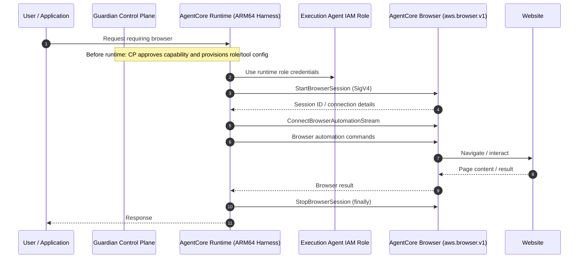
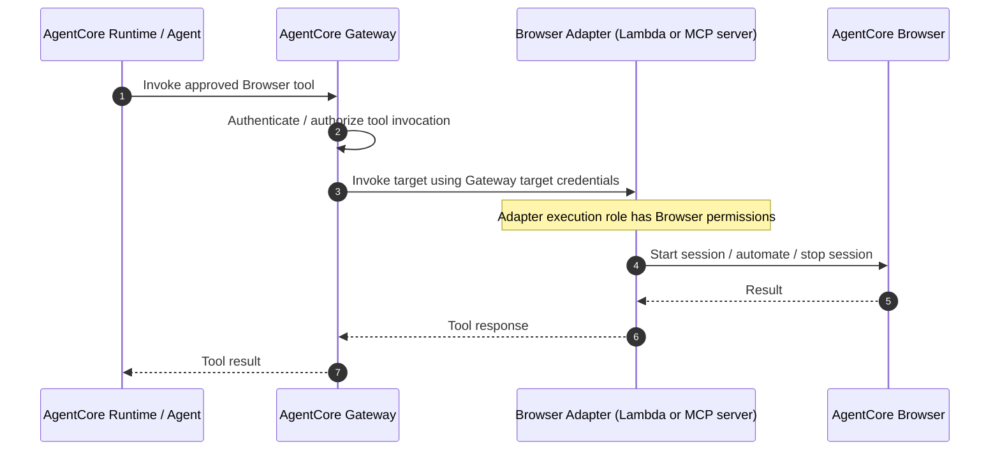
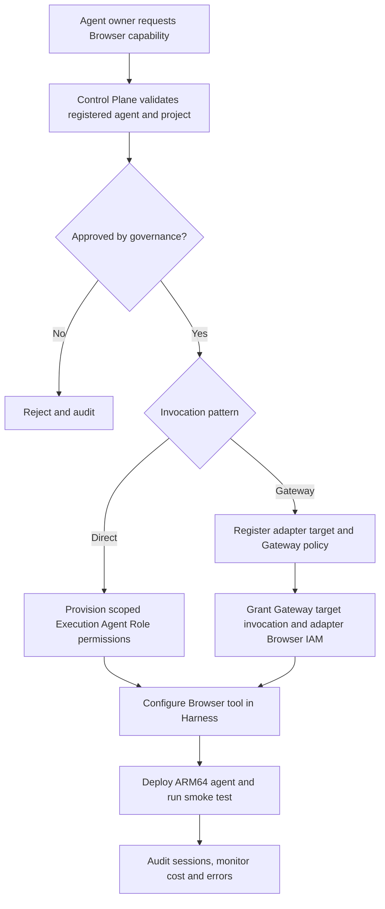

# Guardian AI Control Plane — AgentCore Browser Integration

**Status:** Draft for Technical Governance  
**Runtime:** AWS Bedrock AgentCore Runtime, ARM64 / Graviton-compatible container  
**Browser:** AWS-managed built-in `aws.browser.v1`  
**Owner:** Guardian AI Platform / Control Plane

## 1. Purpose and decision

Enable approved agents deployed through the Guardian Control Plane to use the AWS-managed AgentCore Browser for web navigation and automation. **Recommended Phase 1:** invoke Browser directly from the AgentCore Harness using the **Control Plane Execution Agent Role**. **Alternative:** expose a Browser adapter through AgentCore Gateway; in that case, permissions to Browser belong to the adapter's actual execution identity, **not automatically** the Control Plane Execution Gateway Role.

The Browser is a separate managed service, not a browser bundled into the ARM64 agent container. Deploying an agent does not automatically enable Browser access.

## 2. Direct invocation — recommended



**Execution:** The agent's Harness decides to call a configured Browser tool (for example, an SDK/Playwright adapter). AgentCore Browser hosts the actual browser session. The agent's execution role signs Browser API requests. Close sessions on success, error, and timeout.

## 3. Gateway-mediated invocation — alternative



**Role distinction:** For a **Lambda target**, the Control Plane Execution Gateway Role needs `lambda:InvokeFunction` on that target; the **Lambda execution role** needs Browser session permissions. For an MCP/HTTP adapter, its workload identity needs Browser permissions. Only assign Browser permissions to the Gateway role if that role is genuinely the principal calling Browser APIs. Gateway is not itself a built-in Browser automation executor.

## 4. IAM permission matrix

| Identity | Required permissions | Purpose |
|---|---|---|
| **Control Plane Execution Agent Role** (direct) | `bedrock-agentcore:StartBrowserSession`, `GetBrowserSession`, `ConnectBrowserAutomationStream`, `StopBrowserSession` | Run Browser sessions directly |
| **Agent caller** (Gateway option) | `bedrock-agentcore:InvokeGateway` scoped to approved Gateway | Invoke the Browser tool exposed by Gateway |
| **Control Plane Execution Gateway Role** (Lambda target) | `lambda:InvokeFunction` scoped to Browser adapter | Invoke adapter; no Browser permissions by default |
| **Browser adapter execution role** | Same Browser session permissions as direct agent role | Perform Browser operations |
| **Control Plane management role** | Browser creation/configuration actions only if custom Browser resources are used | Provision resources, not ordinary built-in Browser sessions |

### 4.1 Browser session policy — direct agent role OR adapter role

Replace `<REGION>` and `<ACCOUNT_ID>`. The resource scope below is a **starting template**, not a validated least-privilege production policy. Confirm the built-in system-browser ARN and per-action resource-level support in the target account and AWS Service Authorization Reference; tighten the resource to `aws.browser.v1` where supported.

```json
{
  "Version": "2012-10-17",
  "Statement": [
    {
      "Sid": "AgentCoreBrowserSessionAccess",
      "Effect": "Allow",
      "Action": [
        "bedrock-agentcore:StartBrowserSession",
        "bedrock-agentcore:GetBrowserSession",
        "bedrock-agentcore:ConnectBrowserAutomationStream",
        "bedrock-agentcore:StopBrowserSession"
      ],
      "Resource": "arn:aws:bedrock-agentcore:<REGION>:<ACCOUNT_ID>:browser/*"
    }
  ]
}
```

`GetBrowser`, `ListBrowserSessions`, `UpdateBrowserStream`, and `ConnectBrowserLiveViewStream` are **optional**, only if implementation/operations require them. Model invocation, CloudWatch, KMS, S3, or Secrets Manager permissions are separate and must be scoped to actual dependencies. Avoid `BedrockAgentCoreFullAccess` for agent execution.

### 4.2 Gateway execution role — Lambda target only

```json
{
  "Version": "2012-10-17",
  "Statement": [
    {
      "Sid": "InvokeBrowserAdapter",
      "Effect": "Allow",
      "Action": "lambda:InvokeFunction",
      "Resource": "arn:aws:lambda:<REGION>:<ACCOUNT_ID>:function:<BROWSER_ADAPTER_FUNCTION>"
    }
  ]
}
```

The calling agent additionally needs Gateway invocation authorization (IAM `bedrock-agentcore:InvokeGateway` for IAM-authenticated invocation, or the configured supported OAuth/JWT flow). If Gateway Policy/Cedar is enabled, include its documented policy-engine permissions in the Gateway role. Cross-account Lambda targets also require appropriate Lambda resource-based permissions.

## 5. Control Plane enablement flow



Control Plane configuration should record: agent/project ID, approval owner, enabled flag, invocation mode, browser identifier, role ARN, allowed destinations (where technically enforceable), session timeout, concurrency limits, and audit correlation ID. These are **proposed Guardian metadata**, not guaranteed native Browser resource settings.

## 6. Runtime and security requirements

- **ARM64 / Graviton:** Build the AgentCore Runtime container and its Python/native dependencies for `linux/arm64`. Use compatible Browser SDK/automation libraries; the actual managed browser does not run in this container.
- **IAM isolation:** If multiple agents share one Execution Agent Role, every agent using that role can inherit its Browser API permissions. Prefer per-agent roles or a separately enforced authorization boundary.
- **Browser authorization:** Require approved capability and restrict destinations via verified network/proxy controls or a trusted adapter. A Control Plane UI flag alone is not an IAM boundary.
- **Action safety:** Require explicit approval for purchases, submissions, data changes, or sensitive actions; guard against prompt injection from web pages.
- **Audit:** Record agent identity, session ID, target domain (without secrets), start/stop timestamps, outcome, and trace correlation; redact credentials and sensitive page content.
- **Operations:** Set session timeouts, concurrency quotas, retry/backoff, and `finally` cleanup. Monitor cost, failures, and session duration.

## 7. Validation checklist / open decisions

- [ ] Verify Browser availability in Guardian target region and built-in resource ARN/IAM resource matching.
- [ ] Validate session start/connect/stop with the actual Execution Agent Role.
- [ ] Confirm ARM64 Harness image and Browser automation dependencies work end-to-end.
- [ ] Decide whether direct Browser access meets destination and audit requirements or a Gateway adapter is required.
- [ ] Confirm per-agent IAM isolation and provisioning/revocation behavior.
- [ ] Test unauthorized agent, denied destination, browser timeout, failed cleanup, and rate-limit cases.
- [ ] Decide whether built-in Browser security controls suffice or a custom Browser resource is necessary.

## 8. AWS references

- [AgentCore Browser quickstart](https://docs.aws.amazon.com/bedrock-agentcore/latest/devguide/browser-quickstart.html)
- [Managing Browser sessions](https://docs.aws.amazon.com/bedrock-agentcore/latest/devguide/browser-managing-sessions.html)
- [StartBrowserSession API](https://docs.aws.amazon.com/bedrock-agentcore/latest/APIReference/API_StartBrowserSession.html)
- [Gateway service role permissions](https://docs.aws.amazon.com/bedrock-agentcore/latest/devguide/gateway-prerequisites-permissions.html)
- [Gateway and Cedar policy permissions](https://docs.aws.amazon.com/bedrock-agentcore/latest/devguide/policy-permissions.html)
- [AgentCore Runtime ARM64 container requirements](https://docs.aws.amazon.com/bedrock-agentcore/latest/devguide/runtime-agui-protocol-contract.html)

**Governance decision requested:** Approve **direct Harness-to-Browser invocation** as Phase 1, subject to IAM isolation, destination controls, auditability, and development-account validation. Retain Gateway-mediated adapter as a governed alternative.
